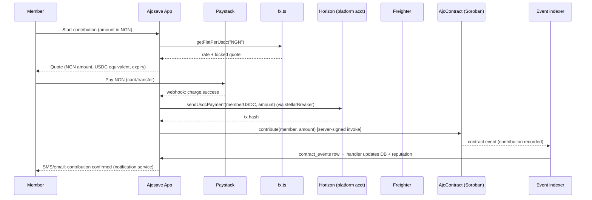

# Stellar / Soroban Integration Reference

One map of every Stellar touchpoint in Ajosave: where USDC enters the system,
how Horizon is called, how the Soroban contract is driven, how Freighter
wallets connect, and how contract events get back into Postgres. Companion
docs: [ngn-to-usdc-flow.md](ngn-to-usdc-flow.md) (the Paystack on-ramp in
detail), [contract-auditor-guide.md](contract-auditor-guide.md) (contract
internals), and [environment-variables.md](environment-variables.md) (all
`STELLAR_*` / `USDC_*` variables).

## Architecture map

| Concern | Code | Notes |
|---|---|---|
| Horizon payments & balances | `src/lib/stellar.ts` | `sendUsdcPayment`, `getUsdcBalance`, exports `horizonServer`, `USDC`, `networkPassphrase` |
| Soroban RPC (deploy, invoke, events) | `src/lib/soroban.ts` | `deployAjoContract`, `invokeContractPayout`, `invokeContractSetPayoutOrder`, `getContractEvents`, `processContractEvents` |
| FX quotes (NGN per USDC) | `src/lib/fx.ts` | `getFiatPerUsdc(currency)` |
| Horizon payment stream | `src/server/services/horizon-stream.service.ts` | Server-Sent Events into the platform account |
| Contract event indexer | `src/server/services/event-indexer.service.ts` | Polls Soroban RPC, persists to `contract_events` |
| Freighter wallet (client) | `src/hooks/useFreighterWallet.ts`, `src/components/wallet/ConnectWalletButton.tsx`, `src/hooks/useWalletMismatch.ts` | Connect, network check, mismatch banner |
| Smart contract | `contracts/ajo/src/lib.rs` | `AjoContract` — Soroban, token (USDC) contract address stored in instance data |
| Circuit breaking | `src/lib/circuit-breaker.ts` | `stellarBreaker` wraps outbound Horizon calls |

Network selection is global: `serverConfig.stellar.network` picks
`Networks.PUBLIC` or `Networks.TESTNET` as the passphrase, the Horizon URL
(`stellar.horizonUrl`), and the Soroban RPC URL (`stellar.sorobanRpcUrl`).
Testnet USDC is the issued asset at
`GBBD47IF6LWK7P7MDEVSCWRRNEIY3K5LFMKYFHGDKS63NWIFQXJ6GSB` (the standard
testnet USDC issuer); mainnet USDC is the native Circle asset — both are
configured via `USDC_ASSET_CODE` / `USDC_ISSUER`, never hardcoded.

## USDC on Stellar

USDC on Stellar is a classic (non-native) asset: `Asset("USDC", issuer)`.
Every account that will **hold** USDC must first hold a **trust line** to
that asset:

```typescript
import { Horizon, Asset, TransactionBuilder, Operation, BASE_FEE, Networks } from "@stellar/stellar-sdk";

const server = new Horizon.Server(horizonUrl);
const usdc = new Asset("USDC", issuer);

// One-time setup per account: establish the trust line
const tx = new TransactionBuilder(account, { fee: BASE_FEE, networkPassphrase: Networks.TESTNET })
  .addOperation(Operation.changeTrust({ asset: usdc }))
  .setTimeout(30)
  .build();
```

Operational notes:

- **Payouts fail without a trust line.** `sendUsdcPayment` will get a
  `op_line_full`-family failure from Horizon if the destination has no trust
  line or is at its `limit`. The UI surfaces this via the wallet
  onboarding path, which creates the trust line before the first payout.
- The **platform account** (`STELLAR_SERVER_SECRET_KEY`) pays out USDC, so
  it holds the asset in bulk; members' Freighter accounts receive it.
- XLM (the native asset) is still required on every account for the base
  fee and reserves — Freighter onboarding instructions cover funding the
  first few stroops of XLM on testnet.

## Horizon API usage

`src/lib/stellar.ts` is the only place the app talks to Horizon directly:

```typescript
const server = new Horizon.Server(serverConfig.stellar.horizonUrl);

// Load an account (404 = account does not exist yet on this network)
const account = await server.loadAccount(publicKey);

// Build + sign + submit a USDC payment
const tx = new TransactionBuilder(account, { fee: BASE_FEE, networkPassphrase })
  .addOperation(Operation.payment({ destination, asset: USDC, amount }))
  .setTimeout(30)
  .build();
tx.sign(keypair);
const result = await server.submitTransaction(tx); // → result.hash
```

All calls go through `stellarBreaker.execute(...)` — a circuit breaker that
fails fast when Horizon is unhealthy instead of stacking timeouts.

### Payment streaming

`startHorizonStream(onPayment)` (`horizon-stream.service.ts`) opens
`server.accounts().accountId(platformAccount).stream(...)` and fires
`onPayment` for each incoming payment operation. It filters for the
configured USDC asset, logs each receipt, and reconnects on stream
closure — Horizon streams drop routinely (deploys, LB idle timeouts), so
the reconnect path is part of normal operation, not an error state.

## Soroban contract interaction

The contract (`contracts/ajo/src/lib.rs`) is an `AjoContract` storing its
members, payout order, and reputation data in instance/storage entries;
the USDC **token contract address** is set at `initialize` and read back
via `get_token`. The TypeScript side (`src/lib/soroban.ts`) talks to it
three ways:

1. **Deploy** — `deployAjoContract()` shells out to the Stellar CLI
   (`stellar contract deploy`) against `stellar.sorobanRpcUrl` and returns
   the contract ID; empty output is treated as failure.
2. **Invoke** — `invokeContractPayout(contractId)` and
   `invokeContractSetPayoutOrder(contractId, order)` build simulation →
   assemble → send sequences through Soroban RPC (`prepareTransaction` /
   `sendTransaction` patterns) signed with the platform keypair.
3. **Read events** — `getContractEvents(contractId, lastLedger?)` pages
   Soroban RPC `getEvents` from a cursor ledger; `processContractEvents`
   filters to the contract and maps raw XDR topics/data into the
   `ContractEvent` interface (`{ type, txHash, topics, data, ledger }`).

Client-side wallet interactions (member `join` / `contribute` calls) go
through Freighter's provider rather than `soroban.ts` — see below.

Key contract entrypoints, for reference when reading indexer handlers:

| Entrypoint | Effect |
|---|---|
| `initialize(token, admin, cycle_length)` | One-time setup |
| `join(member)` | Adds a member |
| `contribute(member, amount)` | Records a cycle contribution |
| `set_payout_order(order)` | Randomized payout order (admin/server) |
| `payout()` | Pays the current cycle's member from the token contract |
| `get_reputation(member)` / `get_reputation_stats(member)` | Reputation reads |
| `pause()` / `unpause()` / `upgrade(...)` | Admin controls (timelocked where applicable) |

## Freighter wallet integration

`useFreighterWallet()` (`src/hooks/useFreighterWallet.ts`) is the single
client entrypoint:

- **Availability** — checks `window.freighterApi` presence; exposes
  `ConnectionState` (`disconnected` / `connecting` / `connected` /
  `error`) so buttons can render Install-Freighter vs Connect states.
- **Connect** — `requestAccess()` prompts the extension; on approval the
  public key is stored in React state (and surfaced to the app through the
  hook's return value). User rejection is caught and rendered as a
  non-throwing error state.
- **Network check** — `getNetwork()` compares Freighter's active network
  passphrase to ours; `useWalletMismatch` + `WalletMismatchBanner` render a
  blocking banner ("Switch Freighter to Testnet") when they disagree —
  the most common support issue in practice.
- **Sign** — transaction signing happens inside Freighter (the user sees
  every payload); the app never holds member keys. After signing, the
  signed XDR returns to the app for `server.submitTransaction` or Soroban
  RPC submission.
- **Verify** — `ConnectWalletButton` verifies the connected key against
  the session/user record; `WalletMismatchBanner` also covers
  "connected wallet ≠ account on file" (`useWalletMismatch.ts`).

## Event indexer architecture

Two independent paths keep chain state in Postgres:

```
Soroban RPC getEvents ──▶ event-indexer.service.ts ──▶ contract_events table
                                       │  (dedup: tx_hash + topic)
                                       └─▶ per-topic handlers (reputation,
                                           payouts, contributions …)

Horizon accounts().stream() ──▶ horizon-stream.service.ts ──▶ onPayment
                                              (USDC receipts to platform)
```

- `startEventIndexer()` polls on an interval from the last processed
  ledger cursor; `pollOnce()` returns how many events it handled (used by
  tests and ops checks). Events are inserted into `contract_events`
  idempotently — `INSERT … ON CONFLICT` on `(tx_hash, topic)` — then each
  handler runs and marks the row `processed = true`. A crash mid-handler
  re-processes on the next poll; handlers are written to tolerate replay.
- `startHorizonStream()` is push-based for payments (low latency for
  crediting members); the indexer is pull-based for contract state changes
  (ordered, resumable, cursor-safe). Do not merge them — they have
  different delivery guarantees.

Ops entrypoints: `getIndexerStatus()` reports `{ running, contractId }`;
stop/start are idempotent.

## Contribution flow sequence (NGN → USDC → contract)



The NGN leg (Paystack checkout, rate lock, webhook verification) is
specified in [ngn-to-usdc-flow.md](ngn-to-usdc-flow.md); this diagram shows
where the Stellar legs attach to it.

## Troubleshooting Horizon errors

| Symptom | Typical cause | Resolution |
|---|---|---|
| `404 / accounts/{id}` ("Account not found") | Account has never existed on this network (fresh Freighter key, or testnet/mainnet mix-up) | Fund it (testnet friendbot or a small XLM send); double-check `STELLAR_NETWORK` and Freighter's network match |
| `400 tx_failed` with `op_line_full` | Destination has no USDC trust line, or is at its balance limit | Establish the trust line (`changeTrust`) or raise the limit before retrying the payout |
| `400 tx_failed` with `tx_insufficient_balance` | Platform account lacks USDC or XLM for fees | Top up the platform account; alert on low balances |
| `400 tx_bad_seq` | Sequence number stale (concurrent submit or replayed tx) | Reload the account and rebuild the transaction; the breaker isolates the burst |
| `429 Too Many Requests` | Horizon rate limiting | The circuit breaker opens; back off and retry — do not loop. Persistent 429s mean reduce poll frequency or request a limit increase |
| `500/503` or connection resets from Horizon | Upstream incident | `stellarBreaker` fails fast; indexer and stream reconnect automatically — check [status.stellar.org](https://status.stellar.org) |
| Stream silently stops delivering | Horizon dropped the SSE connection (normal) | `horizon-stream.service.ts` reconnects automatically; if it does not, restart the service and verify the platform account exists |
| `getEvents` returns events from the wrong ledger range | Cursor advanced past unprocessed events, or contract ID mismatch | Verify `CONTRACT_ID` env matches the deployed contract; re-run from the last `processed = false` ledger |
| Freighter popup never appears | Extension locked, or wrong browser profile | User unlocks Freighter; confirm the site is allowed in Freighter's connected-sites list |

When in doubt, reproduce against testnet with a single scripted operation
(`stellar contract invoke … --id <contract> -- contribute …`) before
suspecting app code.

## Keeping this guide current

- `README.md` links here from Getting Started — if the link disappears, CI
  coverage of the docs tree will not catch it, so treat that link as part
  of the contract.
- Review this document whenever `@stellar/stellar-sdk` is upgraded (the
  SDK's deprecation policy governs Horizon API versions) and whenever
  `contracts/ajo/src/lib.rs` gains or renames entrypoints — the tables
  above are the checklist.
- Behavioral changes in `stellar.ts` / `soroban.ts` / the indexer belong in
  the same PR that changes the code.
